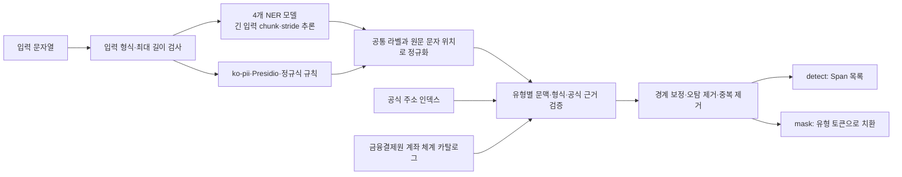

# 아키텍처 및 개인정보 유형별 탐지 방식

이 문서는 `korean-pii-guardrail`이 입력 문자열을 어떤 경로로 검사하고, 지원하는 13개 개인정보 유형을 각각 어떤 근거로 확정하며, 최종 마스킹 범위를 어떻게 결정하는지 설명한다. 설명은 현재 공개 API가 실제로 사용하는 `source/korean_pii/hybrid_pipeline.py`를 기준으로 한다.

## 한눈에 보는 처리 흐름

처리는 다음 순서로 이루어진다.

1. 문자열 여부와 정책의 최대 길이(기본 100,000자)를 확인한다.
2. Frame, Koredact, Atonlee, Seongyeon 모델이 긴 입력을 각 모델의 토큰 길이에 맞춰 겹치는 조각으로 처리한다. 토크나이저가 꼬리 부분을 누락하는 경우에는 수동 진행 경로가 남은 텍스트를 끝까지 처리한다.
3. ko-pii, Presidio와 제한된 정규식 규칙이 형식이 뚜렷한 유형의 후보를 만든다.
4. 모델마다 다른 라벨을 13개 공통 라벨로 바꾸고 원문 기준 문자 위치를 유지한다. 모델 점수는 서로 비교 가능한 보정 확률로 취급하지 않는다.
5. 이름, 주소, 계좌번호 등 문맥이 중요한 유형은 필드명·문장 구조·값의 형식·공식 사전 근거를 함께 확인한다.
6. 조사나 후속 일반 문장을 탐지 범위에서 제외하고, 동일·겹침 span을 정책 우선순위에 따라 하나로 정리한다.
7. `detect()`는 최종 `Span`을 반환하고, `mask()`는 선택된 범위만 `<PERSON>`, `<KR_LOCATION>` 같은 유형 토큰으로 치환한다.

어느 단계에서든 모델 로딩이나 탐지에 실패하면 원문을 반환하지 않고 `DetectionError`를 발생시키는 fail-closed 방식이다.

## 네 모델의 역할

- **FrameByFrame/korean-pii-e5-base**: 이름 후보와 신용카드번호, 생년월일, 사용자명, 계좌번호 후보를 제공하는 전면 모델이다.
- **infobank-corp/koredact-bert-base**: 상세 주소를 담당한다.
- **atonlee/koelectra-ko-pii-ner**: 계좌번호와 여권번호를 담당하고, 명시적 사용자명·사람 역할 필드의 보조 확인에도 사용한다.
- **seongyeon1/ko-pii-ner-roberta-base**: 이름, 운전면허번호, 차량번호를 담당하고, 명시적 생년월일 필드의 보조 확인에도 사용한다.

모델 ID, 고정 revision, 라이선스와 가중치 해시는 `source/korean_pii/model-manifest.json`에 기록되어 있다. 모델 가중치는 이 저장소나 wheel에 포함하지 않는다.

### `candidate`는 별도 모델이 아니다

코드에서 candidate는 Frame 출력, 값의 형식, 필드명 같은 근거로 만든 **검토 전 후보 span 또는 주변 문맥 창**을 뜻한다. `candidate`라는 이름의 다섯 번째 NER 모델이나 별도 가중치는 없다.

현재 결과물은 네 외부 모델을 그대로 하나 선택한 것이 아니라, 네 모델의 역할 분담과 직접 규칙, 공식 근거, 경계·오탐 정책을 이 저장소에서 조립한 하이브리드 파이프라인이다. 어떤 외부 모델을 사용하는지는 `model-manifest.json`, 우리가 만든 결합 로직은 `hybrid_pipeline.py`와 유형별 후처리 모듈에서 확인할 수 있다.

## 지원하는 13개 개인정보 유형

### 1. 이름 — `PERSON`

Frame의 사람 라벨을 기본 후보로 사용하고 Kiwi 형태소 경계 보정으로 뒤에 붙은 조사와 호칭을 정리한다. Seongyeon의 사람 예측은 Frame과 겹치지 않는 이름을 보완하며, 명시적인 담당자·신청인 같은 개인 역할 필드는 Atonlee 또는 엄격한 필드 규칙으로 복구한다.

최종 단계에서는 행정구역명이 사람 이름처럼 나온 경우, 문서 제목·처리 용어·일반 명사를 사람으로 본 경우를 제거한다. 짧은 한글 문자열만으로는 이름을 만들지 않고, 모델 또는 개인 역할 문맥을 요구한다.

### 2. 상세 주소 — `KR_LOCATION`

Koredact의 위치 예측이 기본 근거다. 모델 span이 도로명·지번·건물번호·동·층·호 등 상세 주소 형식의 핵심 부분과 겹칠 때 전체 주소 경계로 보정한다. 공식 행정동·법정동 및 도로명 인덱스는 존재 여부를 확인하는 보조 근거로 사용한다.

공식 사전에 있다는 이유만으로 공공장소를 무조건 마스킹하지 않는다. 사전만으로 주소를 추가할 때는 `주소`, `배송지`, `송달지`처럼 개인 주소임을 나타내는 제한된 필드 문맥이 필요하다. 상세 주소 뒤의 배송 지시나 일반 문장은 보존하며 행 끝까지 확장하지 않는다.

### 3. 계좌번호 — `KR_BANK_ACCOUNT`

Frame과 Atonlee가 숫자열을 계좌번호로 예측한 경우에만 시작한다. 이후 다음 중 하나가 후보와 직접 겹쳐야 최종 계좌번호로 남긴다.

- `계좌번호`, `입금 계좌`, `이체 계좌`, `통장` 같은 명시적 필드와 값의 연결
- 같은 실제 줄 안의 은행·증권·금고·신협 등 금융기관 표현과 금융결제원 계좌 체계 근거
- 기존의 제한된 계좌 문장 구조

금융결제원 카탈로그는 모델 예측을 보강하는 근거이며, 카탈로그만으로 숫자열을 새 계좌번호로 만들거나 카탈로그에 없다는 이유만으로 명시적 계좌 필드를 거부하지 않는다. 다른 줄의 은행명을 빌려오지 않아 제품번호 같은 일반 숫자열의 오탐을 줄인다.

### 4. 전화번호 — `KR_PHONE_NUMBER`

ko-pii의 한국 전화번호 규칙 결과를 사용한다. ASCII 제품·주문 식별자 안에 포함된 숫자 조각과 신용카드번호 내부를 전화번호로 중복 탐지한 경우는 제거한다.

### 5. 이메일 주소 — `EMAIL_ADDRESS`

ko-pii의 이메일 형식 탐지 결과를 사용한다. 최종 중복·겹침 정리 후 이메일 전체 경계만 마스킹한다.

### 6. IPv4 주소 — `IP_ADDRESS`

ko-pii 결과와 자체 엄격 IPv4 규칙을 함께 사용한다. 자체 규칙은 점으로 구분된 네 옥텟이 각각 0부터 255 사이인지 확인한다. 제품 코드처럼 명시적인 ASCII 식별자에 붙은 부분 문자열은 제거한다.

### 7. 신용카드번호 — `CREDIT_CARD`

Frame의 카드 또는 계좌 계열 예측을 사용한다. 계좌 계열로 나온 숫자열도 길이와 Luhn 검증을 만족하면 카드번호로 정규화한다. 동일 숫자열을 전화번호나 계좌번호로 동시에 마스킹하지 않도록 겹침 우선순위에서 신용카드 경계를 선택한다.

### 8. 주민등록번호 — `KR_RRN`

Microsoft Presidio의 한국 주민등록번호 recognizer를 사용한다. 주문번호처럼 더 큰 ASCII 식별자 안에 붙어 있는 주민등록번호 모양은, 주변에 명시적인 주민등록번호 필드가 없는 경우 제외한다.

### 9. 생년월일 — `DATE_OF_BIRTH`

Frame의 날짜 예측을 사용하되 `생년월일`, `출생일`, `태어난 날` 등 출생 의미가 값과 직접 연결된 경우만 남긴다. Frame이 놓친 명시적이며 형식이 유효한 생년월일 필드는 제한된 주변 범위에서 Seongyeon이 동의할 때 복구한다.

일반 일정, 진료일, 배송일 같은 날짜는 생년월일로 마스킹하지 않는다.

### 10. 사용자명 — `USERNAME`

Frame의 사용자명 예측을 시작점으로 사용한다. `사용자명`, `로그인 ID`, `계정명`, `@handle`처럼 값과 직접 연결되는 문맥을 요구하고, 명시적 필드에서 Frame이 놓친 경우에는 제한된 범위에서 Atonlee의 동의를 사용한다. 일부 엄격한 필드·서술 구조는 규칙으로 직접 복구한다.

제품·부품·장치·운송장 코드 문맥은 제외한다. 같은 사용자명이 반복돼도 문자열이 같다는 이유만으로 전파하지 않고, 각 위치에 `동일 계정`, `재확인` 같은 자체 문맥이 있을 때만 추가한다.

### 11. 여권번호 — `KR_PASSPORT`

Atonlee의 여권번호 예측을 사용하며 현재 정책의 원시 모델 점수 기준은 0.90이다. Frame 후보, 여권번호 모양, `여권` 문맥 주변의 제한된 창에서도 Atonlee를 다시 확인해 긴 입력과 경계 변형을 보완한다. 이 점수는 다른 모델과 비교 가능한 확률이 아니다.

### 12. 운전면허번호 — `KR_DRIVER_LICENSE`

Seongyeon의 운전면허번호 예측과 한국 운전면허번호의 완전한 형식 규칙을 함께 사용한다. 형식이 정확한 값은 규칙 경로로도 복구하며, 최종 단계에서 완전한 값 경계로 정규화한다.

### 13. 차량번호 — `KR_VEHICLE_PLATE`

Seongyeon의 차량번호 예측을 사용한다. 지역명 선택부, 2~3자리 숫자, 한글 용도 문자, 4자리 일련번호로 이루어진 전체 차량번호 형식과 겹치는 예측만 남기고 정확한 경계로 보정한다.

## 중복·겹침과 마스킹

동일한 라벨·시작·끝 위치가 여러 경로에서 나오면 규칙과 전문 모델의 출처 우선순위 및 해당 경로의 원시 점수로 하나를 선택한다. 서로 다른 유형의 span이 겹치면 주민등록번호, 카드번호, 계좌번호처럼 더 구체적인 유형을 먼저 선택한다.

마스킹은 뒤쪽 span부터 원문을 치환하므로 앞쪽 문자 위치가 흔들리지 않는다. 기본 토큰은 `<{label}>` 형식이다. 이미 생성된 토큰 안의 문자열은 다시 탐지하지 않으므로 동일 정책으로 재마스킹해도 토큰 내부가 손상되지 않는다.

현재 토큰은 `<PERSON>`처럼 유형만 표현하며, 동일 값에 `<PERSON_1>` 같은 요청 단위 번호를 부여하는 가명화 기능은 제공하지 않는다.

## 긴 입력 처리

각 모델은 토크나이저의 `max_length`와 `stride`를 사용해 겹치는 조각으로 전체 입력을 처리한다. Frame과 Seongyeon은 256/64, Koredact와 Atonlee는 512/128 설정을 사용한다. 오버플로 토큰이 입력 끝까지 도달하지 않는 토크나이저도 별도의 전진 루프로 남은 꼬리 부분을 처리한다.

조각별 결과는 원문 절대 문자 위치로 환산하고, 동일·80% 이상 중첩된 동일 라벨 결과를 정리한다. 애플리케이션 레벨 기본 최대 입력은 100,000자이며 정책에서 변경할 수 있다.

## 공식 주소 및 금융기관 자료의 역할

공식 주소 인덱스는 행정안전부 행정동·법정동 자료와 도로명주소 개발자센터 도로명 자료로 대상 환경에서 생성한다. 저장소에는 원본 DB를 포함하지 않는다.

계좌번호 카탈로그는 금융결제원 CMS 계좌번호 체계 자료를 코드로 정리한 것이다. 금융기관 명칭, 기관 코드, 길이, 그룹, 일부 은행의 과목 코드 근거를 제공하지만 단독 탐지기나 완전한 계좌 유효성 검증기로 사용하지 않는다.

## 현재 범위와 PHI 서버 연동 시 필요한 보완

이 저장소는 문자열 단위 개인정보 탐지·마스킹 엔진이다. OCR, PDF/HWPX/XLSX 파싱, HTTP 서버, WireGuard나 bearer 인증, GCP 저장소 연동은 포함하지 않는다.

현재 지원하지 않는 개인정보 유형은 나이, 환자번호·차트번호다. 건강보험증 번호는 실험적 선택 기능이며 기본값은 꺼져 있다.

CLIC PHI 서버 설계의 `mask_batch(texts)`, 한 요청 안에서 동일 값을 같은 번호 토큰으로 바꾸는 기능, 카테고리별 건수만 반환하는 `findings`, 의료기관·의사 이름과 임상정보 보존 정책은 별도 어댑터와 검증이 필요하다. 따라서 현재 패키지는 PHI 서버를 완성한 결과물이 아니라 그 서버에서 사용할 수 있는 범용 탐지 엔진이다.

## 주요 코드 위치

- 공개 API와 하이브리드 조립: `source/korean_pii/hybrid_pipeline.py`
- 긴 입력 모델 어댑터와 공통 라벨 매핑: `source/korean_pii/adapters.py`
- 직접 규칙 탐지: `source/korean_pii/direct_rules.py`
- 유형별 문맥·경계 정책: `source/korean_pii/precision_policy.py`, `source/korean_pii/postprocess.py`
- 주소 경계 보정: `source/korean_pii/address_boundaries.py`
- 공식 주소 인덱스: `source/korean_pii/gazetteer.py`, `source/korean_pii/address_index_builder.py`
- 계좌번호 근거: `source/korean_pii/bank_account_catalog.py`, `source/korean_pii/bank_account_evidence.py`, `source/korean_pii/bank_account_linking.py`
- 중복·겹침 및 마스킹: `source/korean_pii/merge.py`
- 기본 정책: `source/korean_pii/default-policy.json`
